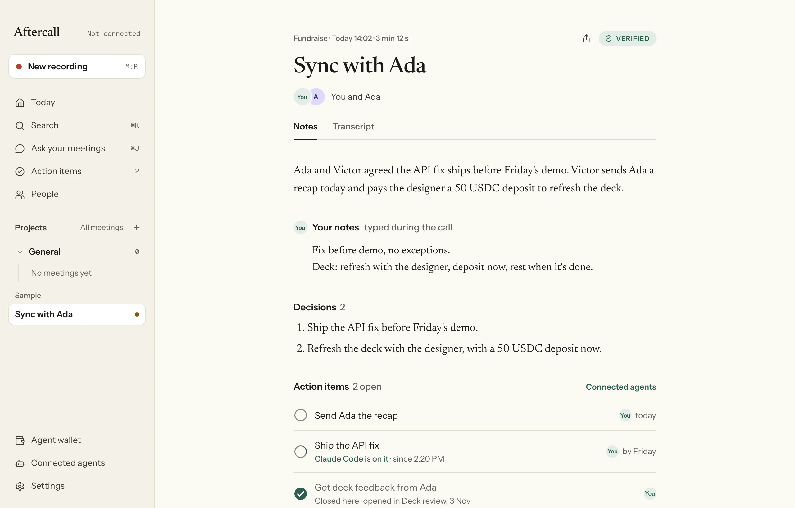

# Aftercall

**Private meeting notes that do the follow-ups.** A Mac app: the notes are made inside NEAR AI Cloud's secure hardware, anyone can check the proof on NEAR, and the meeting sends its own recap and pays what was agreed, within limits a NEAR contract enforces.

[](https://getaftercall.vercel.app/download)
[](https://getaftercall.vercel.app/demo)
[](#for-judges)
[](https://github.com/Don-Vicks/aftercall/actions/workflows/ci.yml)
[](LICENSE)

Built for NEAR HACKATHON (1–14 Nov 2026), tracks: privacy, security, agents, business, realworld. The test build is live for Apple silicon and Intel Macs, and has made notes from real calls on live NEAR AI since 3 Nov 2026.

<picture><source media="(prefers-color-scheme: dark)" srcset="apps/web/public/landing/meeting-dark.webp"></picture>

## What it does

1. **Records the call on your Mac.** Your mic and the call's audio, from any app. No bot joins the call.
2. **Makes the notes inside secure hardware.** Whisper and Qwen run in NEAR AI Cloud's TEEs. The app checks their attestation on every run and encrypts the transcript so only the attested model can read it. Any item without an exact quote from the call is dropped.
3. **Proves it on NEAR.** A hash of the meeting's proof goes on chain, and anyone can re-run the checks in a browser at `/verify`.
4. **Does what the meeting decided.** The recap goes out with a footer saying what was checked. An agreed USDC payment is made after one tap, within the caps of a NEAR contract; anything over a cap waits for your own wallet.

<table>
<tr>
<td width="50%"><picture><source media="(prefers-color-scheme: dark)" srcset="apps/web/public/landing/home-c-dark.webp"></picture><br><sub>Today: what needs you, including a $5,000 payment the contract holds for your wallet.</sub></td>
<td width="50%"><picture><source media="(prefers-color-scheme: dark)" srcset="apps/web/public/landing/privacy-c-dark.webp"></picture><br><sub>Privacy: what stays on the Mac, encrypted, and what goes where.</sub></td>
</tr>
<tr>
<td width="50%"><picture><source media="(prefers-color-scheme: dark)" srcset="apps/web/public/landing/actions-c-dark.webp"></picture><br><sub>Action items across meetings; coding agents can claim them when you allow it.</sub></td>
<td width="50%"><picture><source media="(prefers-color-scheme: dark)" srcset="apps/web/public/landing/palette-detail-dark.webp"></picture><br><sub>Search everything on the Mac with ⌘K: decisions, action items, transcript lines.</sub></td>
</tr>
</table>

## Try it

- **On a Mac:** https://getaftercall.vercel.app/download, or in Terminal: `curl -fsSL https://getaftercall.vercel.app/install.sh | sh`. It's an unsigned test build on NEAR testnet, macOS 14.2 or later; the page shows the one Gatekeeper step.
- **In a browser:** https://getaftercall.vercel.app/demo, the app's interface on sample meetings.
- **From source:** [docs/development.md](docs/development.md).

## For judges

**What it is:** a Mac app that records a call, has NEAR AI Cloud's secure hardware (TEEs) write the notes, and records a proof of that on NEAR that anyone can check in a browser. Then it does what the meeting decided: it sends the recap and pays the agreed USDC from a NEAR contract that caps what the app can spend.

**Three checks, no Mac and no keys needed:**

1. **Run the tests.** `pnpm install && pnpm verify --quick` (Node 24, pnpm 10, stable Rust). You should see a summary of ✓ lines and exit code 0. `pnpm verify` also runs the contract on a local NEAR node (about 8 minutes; needs `cargo-near` and the `wasm32-unknown-unknown` target). On Linux the desktop Rust tests are listed as skipped; they need macOS.
2. **Try the app in a browser.** https://getaftercall.vercel.app/demo is the Mac app's own interface on sample meetings: the notes with their quotes, the Verify sheet, the follow-ups, and the $5,000 payment the contract holds for the owner's wallet. Recording, notes and payments need the Mac app.
3. **See it on NEAR testnet.** The contract is `wallet.aftercall.testnet`. Its history shows the setup and the app's first proof:
   - [register](https://testnet.nearblocks.io/txns/64pwAs3SfUcAJr9vKxGrX6fmhPHzKiUrnKdSWorTEkNz) and [set_cap](https://testnet.nearblocks.io/txns/GDALCrvkRhnMR3qjdpuA9nLVrdFMa4HYSCmwmxhfUuRo), signed in the owner's own NEAR wallet (3 Nov 2026);
   - [record_proof](https://testnet.nearblocks.io/txns/2oawJPTmRiNky6EGzpURh79FRDkFcx4bp1kL76DevZro), sent by the Mac app with its limited key after making notes from a real call on live NEAR AI (3 Nov 2026). That call was a private meeting, so its proof link isn't published; a sample meeting's link for you to open is still to come.
   - Live counts from the contract and the backend: https://getaftercall.vercel.app/stats
   - Without a browser (nearblocks refuses scripted requests), the same facts from NEAR's RPC:
     ```bash
     curl -s https://archival-rpc.testnet.fastnear.com -H 'content-type: application/json' -d '{"jsonrpc":"2.0","id":1,"method":"tx","params":{"tx_hash":"2oawJPTmRiNky6EGzpURh79FRDkFcx4bp1kL76DevZro","sender_account_id":"nov3.testnet","wait_until":"FINAL"}}'
     ```
     shows `nov3.testnet` calling `record_proof` on `wallet.aftercall.testnet` with status `SuccessValue`, and
     ```bash
     curl -s https://rpc.testnet.fastnear.com -H 'content-type: application/json' -d '{"jsonrpc":"2.0","id":1,"method":"query","params":{"request_type":"call_function","finality":"final","account_id":"wallet.aftercall.testnet","method_name":"get_stats","args_base64":"e30="}}'
     ```
     returns the contract's counts as bytes of JSON, `{"wallets":1,"proofs":1,"payments":0,"parked":0}` on 6 Nov.

**Where each claim lives:**

| Claim | Code | Tests |
| --- | --- | --- |
| Nothing is sent unless NEAR AI's TEEs pass attestation; the transcript is end-to-end encrypted to the attested model | `packages/core/src/tee/`, `packages/core/src/notes/pipeline.ts` | `pipeline.test.ts`, `checks.test.ts`, `e2ee.test.ts` |
| The model can't invent a follow-up: anything without an exact quote from the transcript is dropped | `packages/core/src/notes/build.ts` | `build.test.ts` |
| The app's key can only `pay` and `record_proof`, within the caps; over-cap payments wait for the owner's wallet | `contracts/agent-wallet/src/lib.rs` | `contracts/agent-wallet/tests/sandbox.rs` (local NEAR node) |
| Anyone can re-run a proof's checks in a browser | `apps/web/app/verify/` | `verify.test.ts`, `proof.test.ts` |
| The backend keeps nothing about a recap; claim links keep only a token hash and an amount | `apps/backend/src/email/`, `apps/backend/src/claims/` | `email.test.ts`, `claims.test.ts` |

Every claim with its exact test names: [What is proven](docs/proven.md). What has run live and what hasn't: [Live today](#live-today).


## Live today

| What | Where | Status (6 Nov 2026) |
| --- | --- | --- |
| Website, browser demo, install guide | https://getaftercall.vercel.app | Live |
| Test build for Mac (Apple silicon and Intel) | https://getaftercall.vercel.app/download | Live, unsigned, NEAR testnet |
| Backend (sign-in with NEAR, recap email, claim links, counts) | https://aftercall-api.vercel.app/health | Live, with Postgres |
| Contract | `wallet.aftercall.testnet` | Live on testnet: 1 wallet, 1 proof, 0 payments |
| Notes from a real call on live NEAR AI, proof on NEAR | Mac app | Done 3 Nov (private meeting) |
| Recap email sent through Aftercall (Resend) | Mac app → backend | Done 6 Nov |
| A payment, and the $5,000 hold, on testnet | Mac app | Not yet |
| A sample meeting's public proof link for judges | README | Not yet |
| Test credits (a capped NEAR AI key per tester) | backend | Built and tested, off until Aftercall's NEAR AI account is set up |
| Mainnet: contract, 1Click payout to Solana or Base | | Not yet; testnet is eligible (rules, Q-010) |


## How it works

- **Mac app** (Tauri, Rust and React): records both sides of the call, seals audio and notes on disk with a key in the Keychain, and holds a NEAR key that can only call `pay` and `record_proof`.
- **NEAR AI Cloud:** Whisper and Qwen3.8-27B in TEEs. Every run checks Intel TDX quotes, NVIDIA GPU evidence and the response signature; the transcript is end-to-end encrypted to the attested model, or not sent.
- **NEAR contract** (`contracts/agent-wallet`): proof registry, payee list, daily and per-payment caps; over-cap payments wait for the owner's wallet.
- **Web:** `/verify` re-runs a proof's checks in the browser; `/sign` for owner actions in any NEAR wallet; `/claim` for payees.
- **Backend** (NestJS and Postgres): sign-in with NEAR, recap email through Resend, claim links. It keeps nothing about a meeting.

The full diagram, every check and what each part does with your data: [docs/how-it-works.md](docs/how-it-works.md). Who sees and keeps what: [docs/privacy.md](docs/privacy.md).

## Follow-ups: what leaves, who approves, what's kept

The notes are made inside secure hardware, but a follow-up has to leave it to do anything. This is what each one shares, who can say yes, and what record it leaves.

| Follow-up | What leaves, and to whom | Who approves | What's kept, and where |
| --- | --- | --- | --- |
| Recap, **Draft in Mail** (the default) | The summary, decisions and open action items, to your own mail app. Nothing goes to Aftercall's servers | You, when you send it from Mail | Your mail provider. On the Mac: when you drafted it |
| Recap, **Send through Aftercall** | The same recap, to Aftercall's backend (in memory for one request), then Resend, then the recipient | You tap Send, with a 5-second undo. Autopilot sends only to team domains you list, with a 60-second undo | Resend keeps sent mail under its own policy; the backend keeps a count. On the Mac: the time sent and Resend's email id |
| **Payment within your caps** | The payee's NEAR account and the amount, to NEAR, with a fixed memo ("Aftercall payment") and an id made of the recording's start time and the follow-up's number. No meeting title or text | You tap Approve. Autopilot pays only listed payees within your per-payment cap and today's allowance, with a 60-second undo. The contract checks the payee list and both caps either way | On NEAR, publicly and for good. On the Mac: the transaction hash |
| **Payment over a cap** | The same, parked on the contract instead of paid | Only your own NEAR wallet, on the `/sign` page, can approve or decline it. The app's key can't | On NEAR: the parked payment and your decision |
| **Payment on Solana or Base** (NEAR Intents 1Click) | The amount, the payee's address and your refund account, to the 1Click API; then the payment, to NEAR | As above, and only for payees you opted in, under a cross-chain cap that is 0 (off) until your wallet sets it. Over that cap it's refused, not parked | 1Click's own policy; NEAR as above |
| **Claim link** for a new payee | A token hash and the amount, to Aftercall's backend. The payee's name and the meeting title stay in the link itself | The payee chooses where to be paid; you confirm them as a payee in your own wallet | Backend: the token hash, owner, amount, expiry, status and the account the payee shared |
| **Changing your caps, payees or pause** | A transaction from your wallet, to NEAR | Only your wallet. Each change needs 1 yoctoNEAR attached, which the app's limited key can't attach | On NEAR |
| **Coding agents** (Claude Code, Codex) | Nothing leaves the Mac: agents read meetings over a socket only the running app opens | You. Agents are off by default; claiming and completing action items is a second switch, also off. Agents can never send, pay or change your rules | On the Mac: a sealed list of each read, claim and refusal (the newest 200), never meeting content |

Every meeting also leaves a proof on NEAR, for good: the recording's start time, a hash and the model name, never the meeting itself. The proof link you share carries the checks, hashes and counts, your logged notice and your NEAR account, never the notes or the transcript. Everything else, the field-by-field list with file and line pointers: [docs/privacy.md](docs/privacy.md).

## NEAR pieces used

| Piece | Where |
| --- | --- |
| NEAR AI Cloud: Confidential TEE models (Whisper, Qwen3.8-27B) through the OpenAI-compatible API; attestation reports verified the way [the verification docs](https://docs.near.ai/cloud/verification) and NEAR's [reference verifier](https://github.com/nearai/nearai-cloud-verifier) describe; response signatures; end-to-end encrypted chat | `packages/core/src/tee/` (checks, NVIDIA, E2EE), `packages/core/src/notes/pipeline.ts`; Rust `apps/desktop/src-tauri/src/attest.rs` (TDX quotes with dcap-qvl, NRAS) and `nearai.rs` |
| A NEAR smart contract (near-sdk 5.29): caps, payees, parked payments, proof registry, per-user storage | `contracts/agent-wallet` |
| Function-call access keys as the app's limited authority; the 1-yocto rule for owner methods | `crates/near-tx`, `contracts/agent-wallet` |
| NEP-141 (Circle USDC): `ft_transfer_call` deposits, payee registration with `storage_deposit` | `contracts/agent-wallet`, `packages/core/src/wallet/actions.ts` |
| NEP-413 sign-in, signed by the app's key in Rust and verified in TypeScript | `crates/near-tx`, `apps/backend/src/auth` |
| NEAR Connect, for owner signatures in any wallet (Meteor, Intear, Ledger, NEAR CLI…) | `apps/web/app/sign` |
| JSON-RPC: views, `send_tx`, access-key checks | `crates/near-tx`, `apps/web/app/verify` |
| NEAR Intents 1Click: quotes and deposit addresses for paying a payee in USDC on Solana or Base | `packages/core/src/intents/oneclick.ts`, `contracts/agent-wallet` (`pay` with `cross_chain`), [docs](docs/near-intents-1click.md) |
| Testnet and mainnet from one network config (FastNEAR RPC, Circle USDC ids, explorers) | `packages/core/src/network.ts`, `crates/near-tx` |


## More

| | |
| --- | --- |
| [docs/proven.md](docs/proven.md) | Every claim with the tests that check it, and what has run live |
| [docs/how-it-works.md](docs/how-it-works.md) | Architecture, the checks on every run, privacy in detail |
| [docs/privacy.md](docs/privacy.md) | What leaves the Mac, and who keeps what |
| [docs/development.md](docs/development.md) | Running every part locally, and what each check shows |
| [docs/plan.md](docs/plan.md) | The build plan by milestone, and the submission checklist |
| [docs/agents-demo.md](docs/agents-demo.md) | Claude Code on Aftercall's MCP server |
| [docs/near-intents-1click.md](docs/near-intents-1click.md) | Paying a payee on Solana or Base through NEAR Intents 1Click |
| [docs/staking-for-inference.md](docs/staking-for-inference.md) | Paying for notes by staking NEAR |

## Built with

Disclosed per the hackathon FAQ (Q-005).

- **AI-written code:** most of this repository was written by Claude Code (Anthropic's coding agent) under Victor's direction, from Victor's own plan and design. Commits carry a `Co-Authored-By: Claude` line.
- **No templates or pre-existing project code.** Everything here was written from 26 Oct 2026. The attestation checks follow NEAR's [reference verifier](https://github.com/nearai/nearai-cloud-verifier) and the [NEAR AI Cloud agent skill](https://github.com/near/agent-skills/tree/main/skills/near-ai-cloud); the TDX test fixtures are Phala's sample quote and collateral (MIT), in `apps/desktop/src-tauri/tests/fixtures`.
- **Libraries:**
  - Desktop: Tauri 2 (with tauri-plugin-notification), React 19, Tailwind CSS 4, motion, lucide-react; Rust: cidre (Core Audio tap), cpal, hound, reqwest, keyring, objc2-event-kit, dcap-qvl (Phala, Intel TDX quote verification), bip39, chacha20poly1305, hkdf, sha2, bs58, zeroize
  - Shared core: zod, @noble/curves, @noble/hashes, @noble/ciphers; `pnpm sample:notes` uses @phala/dcap-qvl-node
  - Backend: NestJS, pg, jose, @scure/base
  - Web: Next.js, @hot-labs/near-connect
  - MCP server: @modelcontextprotocol/sdk
  - Contract: near-sdk 5.29, near-workspaces (tests); signer crate: ed25519-dalek
- **Dev tooling:** Playwright for screenshots of every screen (`scripts/screens.mjs`).
- **Design:** made with Claude in an artifact ([Aftercall Screens](https://claude.ai/artifact/RXNzkVE5TXbVu2ynPKRScW)); fonts Newsreader, Instrument Sans and Geist Mono.


## License

[MIT](LICENSE).
